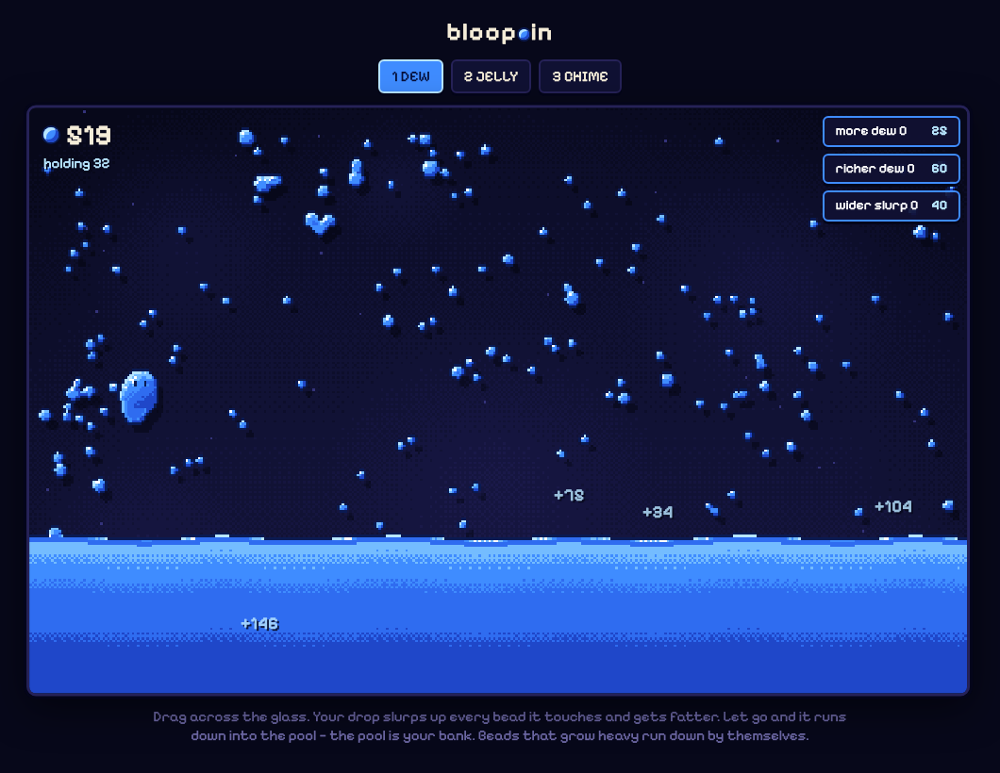
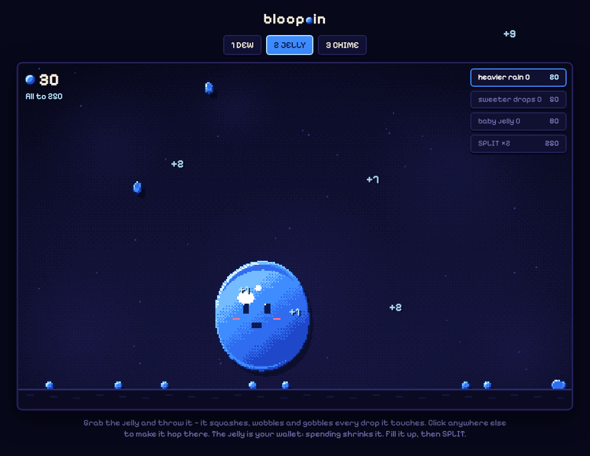
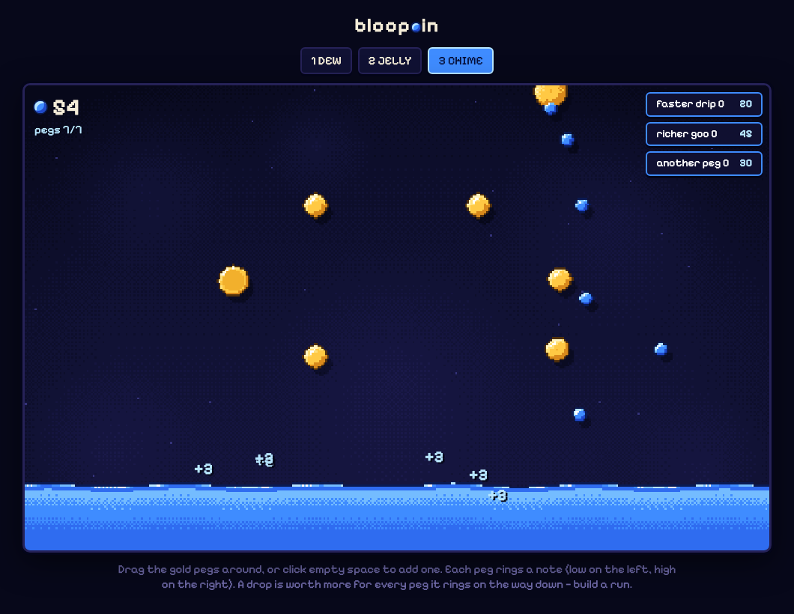

# bloop.in

A gloopy, minimal, slightly retro incremental game about a blue dot of goo.

This repo is at the prototype stage: a handful of small playable toys used to find out which kind of goo feels best before building the real game.

## Play

Open `index.html` in a browser. There is no build step and nothing to install.

Switch prototypes with the tabs or the `1` `2` `3` keys. Click once to turn sound on.

## Prototypes

### 1 · Dew

A cold window covered in dew. Drag a drop across the glass and it slurps up every bead it touches. Let go and it runs down into the pool, which is your bank.

### 2 · Jelly

One big jelly you can grab, stretch and throw. It squashes, wobbles and eats the rain. The jelly is your wallet, so spending shrinks it. Fill it up, then split it.

### 3 · Chime

A goo music box. Drips ring a note on every peg they hit, and a drop is worth more the longer its run of notes. Drag the pegs to compose.

## How the goo is drawn

Everything gloopy is splatted into a tiny 384×240 field, then each pixel is shaded from the field's value and slope: outline, rim light, shade, deep core and a glint, with ordered dither between tones. Blobs merge and stretch like liquid but stay chunky.

All sound is one synthesised water-drop "bloop" played on a pentatonic scale, so chains of pickups climb in pitch.

## Layout

| Path | What it is |
| --- | --- |
| `index.html` | Current prototypes (renderer, audio and all three toys in one file) |
| `docs/` | Screenshots used in this README |
| `archive/` | Earlier prototype rounds, kept for reference |
