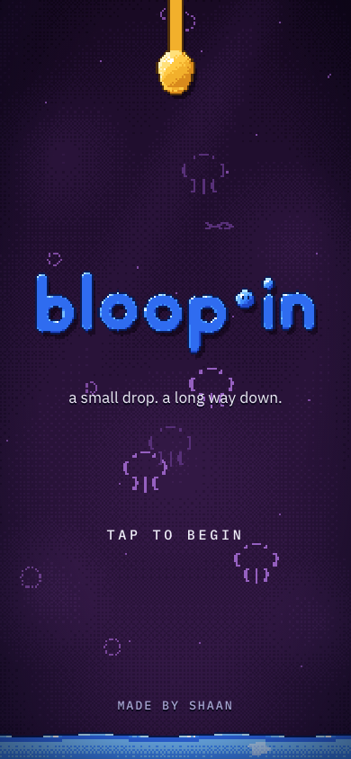

# bloop.in

A small drop. A long way down.

A gloopy, minimal, slightly retro incremental game for phones, played with one thumb.

<p>
  
  
  
  
</p>

## Play

Open `public/index.html` in a browser. There is no build step. It is laid out for a phone held upright and also works with a mouse.

## The game

Bloop is a drip that woke up at an old tap and looked down. Everyone says there is a sea at the bottom.

1. **Aim.** Touch anywhere and the shot points from the tap toward your finger. A dotted line shows the exact path. Slide up past the tap to cancel.
2. **Drop.** Let go. The drop bounces through the pods. Each pod shows how many hits it still needs.
3. **Collect.** Popped pods burst into goo that rains into the pool. That is your haul.
4. **Upgrade.** Spend the haul. Every upgrade changes something you can see on the board.
5. **Go deeper.** Pop every pod in a single round to reach the next depth.

Each depth belongs to one of seven zones (the shallows, kelp forest, jelly gardens, open blue, the trench, moss caves, midnight water), each with its own water colour and its own ASCII wildlife swimming behind the pods.

Every depth you clear washes up a bottle with a note in it, signed "n". There are thirty, and they add up to a story.

From depth 8 you can drain the pool: start again from depth 1 with pearls that make all goo richer for good.

## The deep

The menu has a board called "the deep" that shows how many players are at each depth and who has gone deepest. It is not a score table so much as a map of where everyone is.

The client sends a random id, the name the player picked, their depth and their pearls. Nothing else. The game plays the same with the board unreachable.

Because the game runs entirely in the browser, the board trusts what clients report. Treat it as friendly, not tamper-proof.

## Project layout

| Path | What it is |
| --- | --- |
| `public/index.html` | markup and script tags |
| `public/css/style.css` | all styling; everything is sized in one logical-pixel unit |
| `public/js/render.js` | screen fitting, the goo renderer, zones and ASCII wildlife |
| `public/js/util.js` | small helpers, popups, vibration |
| `public/js/audio.js` | synthesised sound effects and the soundtrack |
| `public/js/story.js` | the thirty notes |
| `public/js/game.js` | save data, upgrades, the round, physics, drawing |
| `public/js/net.js` | client for the deep |
| `public/js/ui.js` | HUD, upgrade sheet, menu, settings, title and intro |
| `public/js/main.js` | input, frame loop, balance bot, boot |
| `functions/api/[[path]].js` | Cloudflare Pages Function behind the deep |
| `wrangler.toml` | Cloudflare Pages configuration |
| `docs/` | screenshots for this README |
| `archive/` | earlier prototypes |

## How it is made

- **Goo.** Blobs are splatted into a 180-pixel-wide field, then every pixel is shaded from the field's value and slope: outline, rim light, shade, core and glint, with ordered dither between tones.
- **Wordmark.** The name on the title screen is built from rows of small goo balls, so it is shaded by the same renderer as the drops and rains into the pool when you start.
- **Wildlife.** Creatures are plain text characters drawn to a hidden canvas and stamped into the backdrop behind the goo.
- **Sound.** All synthesised. Effects are water-drop bloops on a pentatonic scale, so chains climb in pitch. The soundtrack is eight slow bars in the same key, voiced so that only one or two notes move between chords, with a melody built from short repeating phrases.
- **Physics.** Fixed steps. The aim line runs the same code as the drop, so the preview is exact.
- **Saves.** Progress is kept in the browser. Settings can export it as a save code and load one back.

## Hosting on Cloudflare Pages

The game is static files plus one function, so it fits Cloudflare Pages with a D1 database.

```sh
npx wrangler d1 create bloop-in        # prints a database id
# paste that id into wrangler.toml, replacing REPLACE_WITH_YOUR_D1_DATABASE_ID
npx wrangler pages deploy public       # first run creates the Pages project
```

The function creates its tables on first request. If you deploy from the Cloudflare dashboard with Git instead, set the build output directory to `public` and add a D1 binding named `DB` under the project's settings.

The board is recomputed at most once every 30 seconds and kept in a one-row cache table, so most requests read a single row. Each player can write at most once every 15 seconds.

To run everything locally, including the API against a local database:

```sh
npx wrangler pages dev public
```

## Developer switches

Add these to the URL.

| Switch | What it does |
| --- | --- |
| `?bot=300&gh=390` | plays 300 rounds headlessly at a phone ratio and writes a balance log into the page |
| `?auto=3` | skips the title and pre-rolls 3 seconds of auto-play, for screenshots |
| `?deep=12` | starts at depth 12 |
| `?show=title` | with `auto`: also `intro`, `shop`, `note`, `Notes`, `Deep`, `Set` |
| `?fakeworld` | fills the deep with sample data |
| `?buy=drops,power` | with `auto`: buys upgrades through the UI |
| `?cheat=gloop` | with `auto`: enters a cheat code |

## Cheat codes

Settings has a cheat code box. The codes are `gloop`, `deeper`, `abyss`, `pearl`, `rain` and `moon`. A save that has used one stays off the deep.
