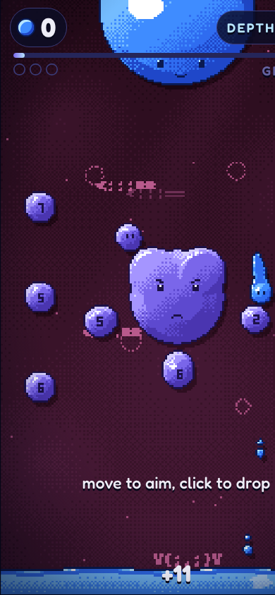
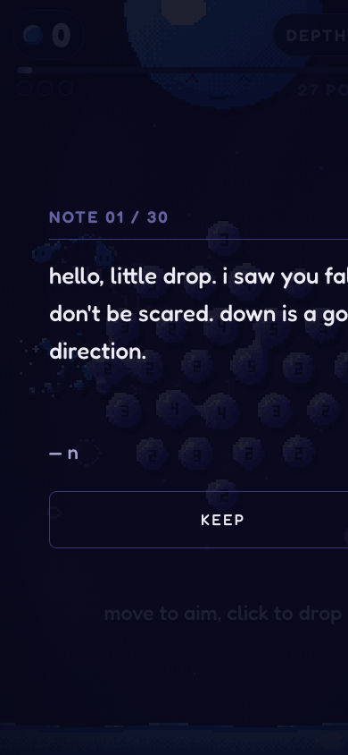
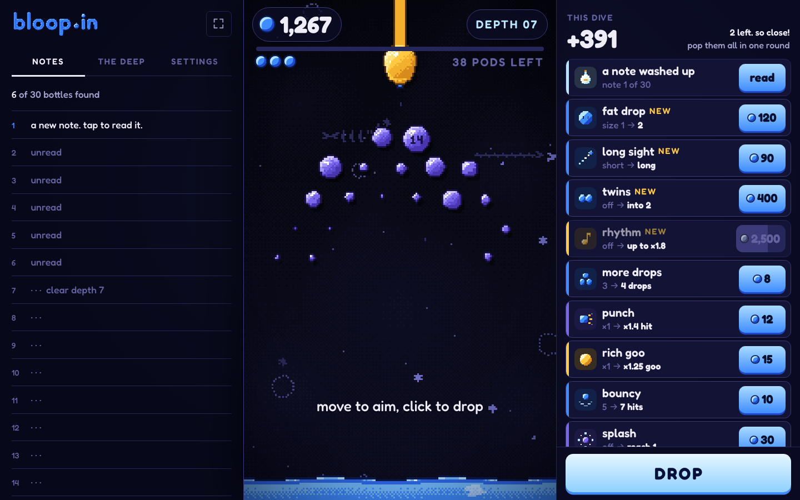

# bloop.in

A small drop. A long way down.

A gloopy, slightly retro incremental game. Aim a drop of goo, pop the pods, spend the goo, go deeper.

**Play it: [bloop.in](https://bloop.in)**

<p>
  
  
  
  
  
</p>



## The game

At the top of the world hangs Oom, the oldest drop there is, far too big to fall. Bloop is the little bit of Oom that looked down. Everyone says there is a sea at the bottom.

1. **Aim.** Touch anywhere and the shot points from Oom toward your finger. A dotted line shows the exact path.
2. **Drop.** Let go. The drop bounces through the pods. Each pod shows how many hits it still needs.
3. **Collect.** Popped pods burst into goo that rains into the pool. That is your haul.
4. **Upgrade.** Spend the haul. Fifteen upgrades unlock as you go deeper, and each one changes something you can see on the board.
5. **Go deeper.** Pop every pod in a single round to reach the next depth.

Along the way:

- **Seven zones** in rotation (the shallows, kelp forest, jelly gardens, open blue, the trench, moss caves, midnight water), each with its own water colour and ASCII wildlife swimming behind the pods.
- **Oom.** A character, not a fixture: it dozes while you shop, watches every drop, winces at a miss and grins at a long chain.
- **Grumps.** Every fifth depth is a duel with a pod that has napped far too long (grum, snorl, glug, hush, knot, dooze). It floats in the pool and plays your own game back at you, upside down, through a wall of pods that is in your way and is also your shield.
  - Every drop you let go, it answers, often with your own shot mirrored. Its drops are pink and float up.
  - Each one that reaches Oom is a yawn: the grump dozes back a little and the dive's goo is worth less. Three yawns and Oom nods off.
  - A fresh drop of yours turns one of its drops into one of yours.
  - After each handful it has to yawn. A drop in the yawn counts triple, and the aim line turns gold when a shot will land there.
  - What you knock off stays off between dives. At the very end it gives one last long yawn: land the last drop in it and the jackpot doubles.
  - Wake a grump and it leaves pearls, comes along for good with a trick of its own, and catches one drop a dive from every grump after it.
- **Thirty notes in bottles**, one for each depth you clear, signed "n". Together they tell a story.
- **Pearls.** Every pearl makes all goo richer for good. Grumps sleep on them, and from depth 8 you can drain the pool: start again from depth 1 with more.
- **The deep.** A shared board in the menu showing how many players are at each depth and who has gone deepest.
- **Save codes.** Progress is kept in the browser; settings can export it as a code and load one back.

## Phone and desktop

The game is built for a phone held upright and played with one thumb.

On a wide screen the play column stays exactly the same, the menu docks on its left and the upgrades on its right. Move the mouse to aim and click to drop.

| Key | What it does |
| --- | --- |
| space or enter | start the round, continue, close a note |
| 1 to 9 | buy the first to ninth upgrade in the list |
| shift (hold) | speed up the last drops |
| f | full screen |

Full screen is also a switch in settings on phones that allow it.

## How it is made

Plain HTML, CSS and JavaScript. No build step, no framework, no image or sound files.

- **Goo.** Blobs are splatted into a 180-pixel-wide field, then every pixel is shaded from the field's value and slope: outline, rim light, shade, core and glint, with ordered dither between tones.
- **Wordmark.** The name on the title screen is built from rows of small goo balls, shaded by the same renderer, and rains into the pool when you start.
- **Wildlife.** Creatures are plain text characters drawn to a hidden canvas and stamped into the backdrop behind the goo.
- **Sound.** All synthesised in the browser. Effects are water-drop bloops on a pentatonic scale, so chains climb in pitch. The soundtrack is eight slow bars in the same key, voiced so only one or two notes move between chords.
- **Physics.** Fixed steps. The aim line runs the same code as the drop, so the preview is exact.
- **Icons.** Sixteen-pixel icons drawn in code.

## Project layout

| Path | What it is |
| --- | --- |
| `public/index.html` | markup and script tags |
| `public/css/style.css` | all styling, sized in one logical-pixel unit |
| `public/js/render.js` | screen fitting, the goo renderer, zones and wildlife |
| `public/js/audio.js` | sound effects and the soundtrack |
| `public/js/story.js` | the thirty notes |
| `public/js/game.js` | save data, upgrades, the round, physics, drawing |
| `public/js/ui.js` | HUD, upgrade list, menu, settings, title, intro, desktop layout |
| `public/js/net.js` | client for the deep |
| `public/js/main.js` | input, frame loop, balance bot, boot |
| `public/js/util.js` | small helpers |
| `functions/api/[[path]].js` | the API behind the deep |
| `wrangler.toml` | Cloudflare configuration |
| `docs/` | screenshots for this README, and `design-notes.md`: why things are the way they are |
| `archive/` | earlier prototypes, kept for reference |

## Running it

Open `public/index.html` in a browser. Everything works from the file except the deep, which needs the API.

To run the API too, against a local database:

```sh
npx wrangler pages dev public
```

## Hosting

The live site is a Cloudflare Pages project (`bloop-in`) with a D1 database (`bloop-in`) bound as `DB`, served at bloop.in. `www.bloop.in` forwards to it so saves stay at one address.

Releases are two separate steps:

1. Every change is committed and pushed here, so any version can be restored.
2. Publishing is done by hand, when a version is ready:

```sh
npx wrangler pages deploy public --project-name bloop-in --branch main
```

The API creates its tables on first request. The board is recomputed at most once every 30 seconds and each player can write at most once every 15 seconds. It trusts what browsers report, so treat it as friendly rather than tamper-proof. It stores a random id, a chosen name, depth and pearls, and nothing else.

## Developer switches

Add these to the URL.

| Switch | What it does |
| --- | --- |
| `?bot=300&gh=390` | plays 300 rounds headlessly at a phone ratio and writes a balance log into the page |
| `?auto=3` | skips the title and pre-rolls 3 seconds of auto-play, for screenshots |
| `?deep=12` | starts at depth 12 |
| `?show=title` | with `auto`: also `intro`, `shop`, `note`, `Notes`, `Deep`, `Set` |
| `?fakeworld` | fills the deep with sample data |
| `?buy=drops,power` | with `auto`: buys upgrades through the UI |
| `?cheat=gloop` | with `auto`: enters a cheat code |
| `?pals=3` | sets how many grumps ride along |
| `?bhp=10` | grump toughness, for balance runs |
| `?wit=.4&hold=1.5` | with `bot`: how often the bot aims at the grump, and how long it waits between drops in a duel |

## Cheat codes

Settings has a cheat code box: `gloop`, `deeper`, `abyss`, `pearl`, `rain`, `moon`. A save that has used one stays off the deep.

Made by Shaan.
