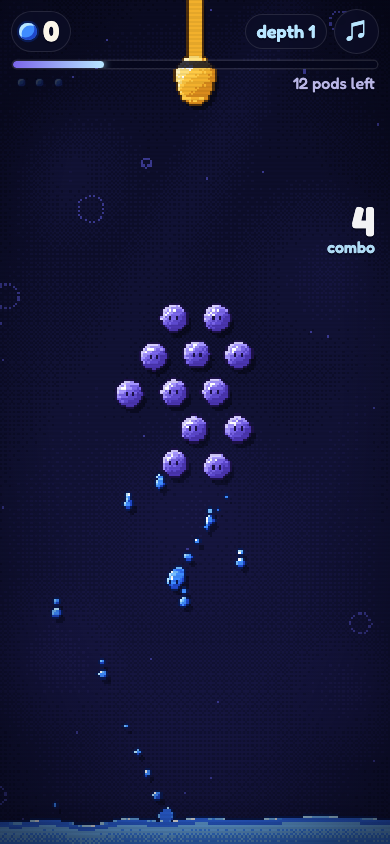
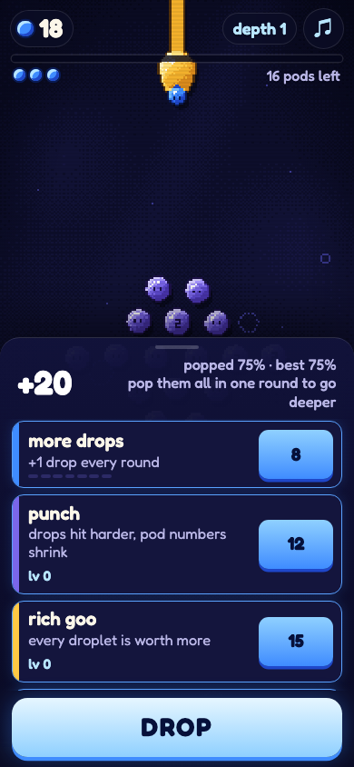

# bloop.in

A gloopy, minimal, slightly retro incremental game about a blue drop of goo. Built for phones, played with one thumb.

  
  

## Play

Open `index.html` in a browser. There is no build step and nothing to install. It is laid out for a phone held upright, and also works with a mouse.

## How it plays

1. **Aim.** Touch anywhere and the shot points from the tap toward your finger. A dotted line shows the path. Slide up past the tap to cancel.
2. **Drop.** Let go. The drop bounces through the pods. Each pod shows how many hits it still needs.
3. **Collect.** Popped pods burst into goo that rains into the pool. That is your haul for the round.
4. **Upgrade.** Spend the haul on upgrades. The next board is already waiting behind the sheet.
5. **Go deeper.** Pop every pod in a single round to reach the next depth: tougher pods, richer goo, a new colour of water, and new upgrades.

Finish a round with 90% or more popped and you get one last-chance drop. From depth 8 you can drain the pool: start again from depth 1 with pearls that make all goo richer for good.

## Upgrades

| Upgrade | What you see |
| --- | --- |
| more drops | one more drop each round |
| punch | the numbers on the pods shrink |
| rich goo | fatter droplets, bigger hauls |
| bouncy | drops bounce higher and survive more hits |
| splash | a popped pod hurts its neighbours |
| fat drop | a bigger drop |
| long sight | a longer aim line |
| twins | a drop splits on its first hit |
| rhythm | long combos turn the goo gold |
| skipping stone | drops skip back off the pool |
| gold pods | gold pods worth 8× |
| leaky tap | free little drops dribble from the tap |
| tadpoles | popped pods can hatch a mini drop |
| boom pods | pods that blow up everything near them |
| heavy | plough straight through the first pods |

## How it is made

Everything is one HTML file with no dependencies beyond a web font.

- **Goo.** Blobs are splatted into a 180-pixel-wide field, then each pixel is shaded from the field's value and slope: outline, rim light, shade, core and glint, with ordered dither between tones.
- **Sound.** All synthesised in the browser. Effects are water-drop bloops on a pentatonic scale, so chains climb in pitch. The soundtrack is a slow generative piece in the same key that brightens as the combo grows. The button in the corner cycles music and sound.
- **Physics.** Fixed steps, and the aim line runs the same code as the drop, so the preview is exact.

## Developer switches

| URL | What it does |
| --- | --- |
| `?bot=300&gh=390` | plays 300 rounds headlessly at a phone ratio and writes a balance log into the page |
| `?auto=3` | pre-rolls 3 seconds of auto-play, for screenshots |

## Layout

| Path | What it is |
| --- | --- |
| `index.html` | the game |
| `docs/` | screenshots used in this README |
| `archive/` | earlier prototype rounds, kept for reference |
